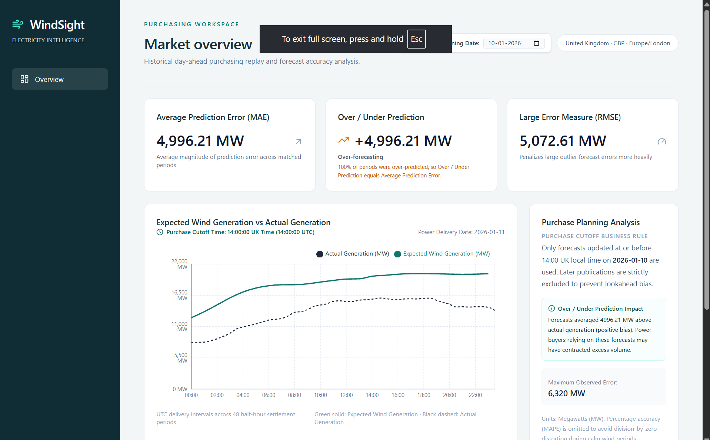

# WindSightFrontEnd

React and JavaScript dashboard shell for WindSight, built with Vite, Tailwind CSS, Lucide React and Recharts. Initial setup only: no market data, authentication or database.

## Application preview



## Run locally

Requires Node.js 22.14+ (22.x) and npm. From this repository root:

```powershell
npm ci
Copy-Item .env.example .env
npm run dev
```

Use `cp` in place of `Copy-Item` on macOS/Linux. Open http://localhost:5173.
Run the WindSightBackend service at http://127.0.0.1:8000. The default Vite proxy forwards `/api` requests to it. Change `API_PROXY_TARGET` in `.env` if needed, then restart Vite. The dashboard displays connection status and supports retrying a failed health check.

When frontend and backend are deployed at different addresses, set `VITE_API_BASE_URL` during the frontend build, for example `https://windsight-backend.onrender.com/api`. Add the deployed frontend address to the backend's `FRONTEND_ORIGINS` setting. `VITE_` values are visible in browser code and must not contain secrets.

`src/components/layout/` contains the layout, `src/components/dashboard/` contains dashboard panels, and `src/components/charts/` is reserved for future charts. `src/services/api.js` centralises backend requests. `src/pages/DashboardPage.jsx` contains the dashboard shell, rendered by `src/App.jsx`. Tailwind uses its Vite plugin and `src/styles.css`. Recharts is installed for future charts; no sample market values are shown.

## Build and preview

```powershell
npm run build
npm run preview
```

Preview opens at http://localhost:4173 and uses the same API proxy. A static production host needs a reverse proxy for `/api`. Never store secrets in frontend environment variables.

## Docker

The Dockerfile builds static assets and serves them through Nginx. Its `/api` proxy expects a backend service named `backend` on port 8000 in the same Docker network. Use the parent workspace's `docker-compose.yml` to run both services at http://localhost:8080.
